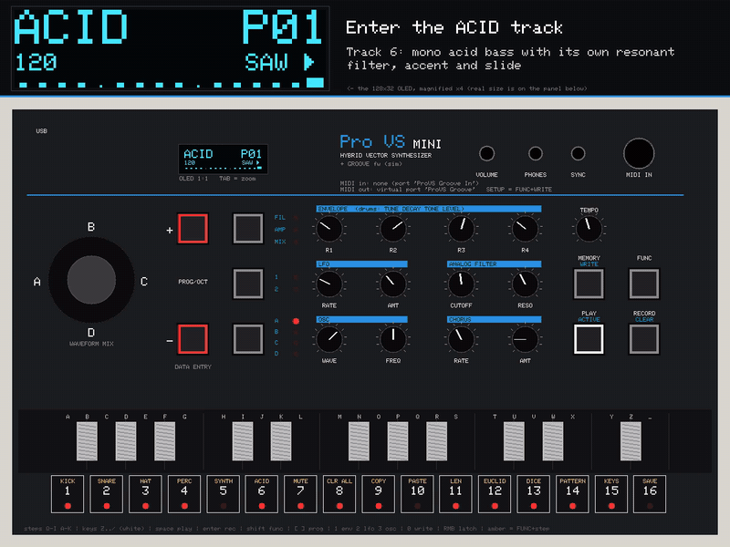
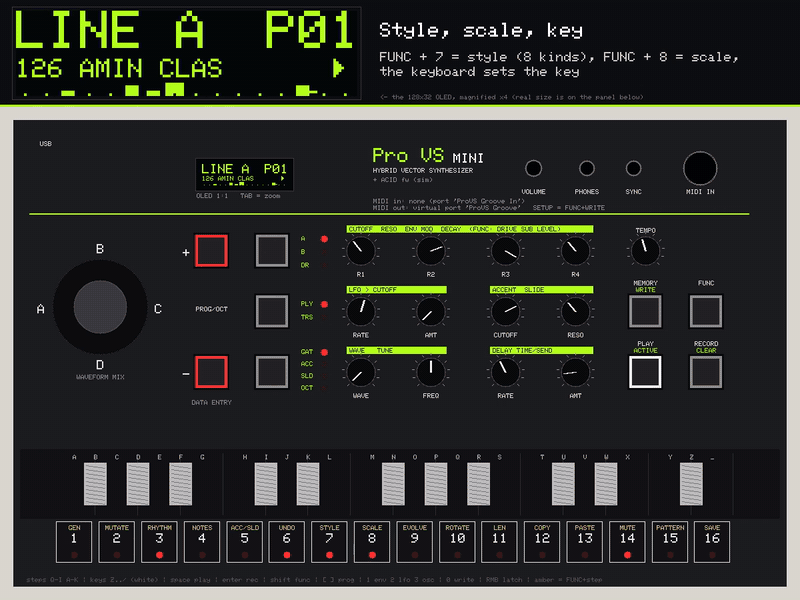

# ProVS Groove

A groovebox firmware for the **Behringer PRO-VS MINI**: four synthesized drum tracks, the vector synth and an acid bass line, a 16-step sequencer with parameter locks, and MIDI clock / SYNC.

There are two firmwares in this repo, sharing the panel code and the simulator: **ProVS Groove** (this page, below) and **[ProVS Acid](#provs-acid-a-dedicated-acid-firmware)**, a dedicated acid machine with a pattern generator.

Right now it is a portable C++ engine and a desktop simulator of the real panel (macOS, SDL2). **It cannot be put on the hardware yet**: there is no safe, supported way to flash the PRO-VS MINI. See [Getting it onto the hardware](#getting-it-onto-the-hardware).



**[▶ Full demo video with sound (54 s, MP4, downloads)](https://github.com/latepilot/ProVS-Groove/raw/main/docs/demo.mp4)**: drums, vector synth and the acid track, all running in the simulator.

> **Made with AI.** I vibe-coded this project with Claude (Anthropic). Claude wrote the code; I set the direction and tested it. It is new code written from scratch, with no factory firmware, decompiled code or other proprietary material.

## Build and run

```bash
./build.sh            # bin/render (tests) + bin/provs-groove-sim
./bin/render out      # self-tests, out/demo.wav, OLED dumps, CPU benchmark
./bin/provs-groove-sim
./bin/provs-groove-sim --video out/demo   # scripted demo video -> out/demo.mp4 (needs ffmpeg)
./bin/acid-test out   # ProVS Acid self-tests, out/acid_demo.wav
./bin/provs-acid-sim  # ProVS Acid simulator (--video out/acid for its demo)
```

Needs clang and SDL2 (`brew install sdl2`). Homebrew's SDL2 in `/usr/local` is x86_64, so the simulator is built for x86_64 and runs under Rosetta; `build.sh` picks the architecture from your SDL2. The engine and tests build natively.

## What's inside

| Track | Engine | Models (OSC button) |
|---|---|---|
| KK | synth kick: sine + pitch envelope + click + drive | DEEP / PUNCH |
| SN | 2 tones + noise through an SVF | SNARE / RIM |
| HH | 6 metallic squares (808 ratios) + noise | CLOSED / OPEN |
| PC | multi-percussion | CLAP / TOM / COWBELL / ZAP |
| SY | vector synth: 5 voices × 4 oscillators (A B C D) with ±24 semitone tuning, 32 built-in waves, joystick mix, 2 LFOs (vector / cutoff), AMP and FIL envelopes, **an envelope per oscillator** (the vector mix moves over time), **a digital filter per voice** (LP12 / LP24 / BP / HP, with its own envelope per note), then one shared filter like the original | — |
| AC | acid bass: mono saw/square, resonant 4-pole low-pass with a decaying envelope, accent (with the sweep that builds up on consecutive accents), slide, drive | SAW / SQUARE |

Sequencer: 16 patterns × 5 tracks × 16 steps. Each track has its own length (polymeter). Per step: accent, probability (1/8…8/8), ratchets ×1–4, a p-lock on any parameter, and on the synth a chord of up to 3 notes and a gate of 1–16 steps, on the acid track a note, gate and slide. There is swing 50–75 %, a tempo-synced ping-pong delay with a send on every track, Euclid fills, DICE (random variation), and copy/paste of a track or a pattern.

## Panel mapping

The layout follows the real panel (traced from photos): 16 step buttons with LEDs, a touch keyboard F…G (27 keys), the joystick, the ENV / LFO / OSC selectors with LEDs, and the 128×32 OLED.

**Step buttons 1–16.** Tap toggles a step. The LEDs show the track and the running light. Hold a step and turn a knob to set a p-lock.

| While holding a step | Action |
|---|---|
| knob | p-lock |
| joystick | lock vector XY (synth) / tune+tone (drums) |
| keyboard key | step note; several keys = chord (acid is mono: last key wins). On a drum track: pitch (TUNE lock) |
| PROG − / + | probability |
| FUNC + PROG − / + | note length (gate) on the synth and acid |
| ENV | accent |
| LFO | ratchet ×1→×4. On the acid track: **slide** (FUNC + LFO = ratchet) |
| OSC | clear all locks on the step |

**FUNC + step** (the amber labels in the simulator):

| 1–6 | 7 | 8 | 9 | 10 | 11 | 12 | 13 | 14 | 15 | 16 |
|---|---|---|---|---|---|---|---|---|---|---|
| track KICK SNARE HAT PERC SYNTH ACID | MUTE mode (steps 1–6 mute tracks) | CLR ALL (pattern) | COPY | PASTE | LEN (then step N) | EUCLID (then step N) | DICE | PATTERN (then step N) | KEYS | SAVE |

To clear just the current track use FUNC + RECORD.

**FUNC + MEMORY WRITE** opens SETUP (sync, see below).

While FUNC is held, the screen shows a legend and the LEDs show the current track. Tap FUNC to leave a mode.

| Button | Action |
|---|---|
| PLAY/ACTIVE | start / stop |
| RECORD | live recording of keys and knobs (quantized) |
| FUNC + RECORD | clear the track (like CLEAR on the panel) |
| PROG − / + | pattern −/+ (while playing, switches at the start of the bar) |
| FUNC + PROG − / + | keyboard octave |
| ENV (FIL/AMP/MIX) | synth: what R1–R4 edit, pressing cycles AMP → OSC ENV → FIL → VOICE FLT → MIX. AMP = amp ADSR (AMP LED), OSC ENV = ADSR of the oscillator picked with OSC (AMP LED blinks), FIL = filter ADSR, used by the shared filter and the voice filters (FIL LED), VOICE FLT = per-voice filter cutoff / resonance / envelope amount / mode OFF-LP12-LP24-BP-HP (FIL LED blinks), MIX = vector X, Y, detune, filter envelope (MIX LED) |
| LFO (1/2) | synth: LFO 1 spins the vector, LFO 2 modulates the cutoff |
| OSC (A–D) | synth: which oscillator WAVE and FREQ edit. Drums: model (LEDs A–D) |
| MEMORY WRITE | save (the simulator writes `state/project.pvg`) |

**Knobs on drum tracks:** R1–R4 = tune / decay / tone / level, FREQ = drive, WAVE = crush, LFO RATE = pan, LFO AMT = sweep/snap/noise, CHORUS AMT = send.
**Knobs on the synth:** R1–R4 follow the ENV selector (on envelope pages the OLED draws the ADSR shape next to the value, the stage you turn in bold), WAVE and FREQ (±24 semitones) follow the OSC selector, FUNC+FREQ = detune, LFO RATE/AMT follow the LFO selector, CUTOFF/RESO, FUNC+CUTOFF = filter envelope amount, CHORUS AMT = send.
**Knobs on the acid track:** R1–R4 = cutoff / resonance / env mod / decay, FREQ = tune (±12), WAVE = accent, LFO RATE = drive, LFO AMT = slide time, CHORUS AMT = send. The joystick moves cutoff (X) and env mod (Y) live; hold a step + joystick to lock them.
**Global:** TEMPO (FUNC = swing), CHORUS RATE = delay time (FUNC = feedback).

The keyboard plays the current track: notes on the synth and acid (legato playing on acid glides, and in RECORD it writes slides), a pitched hit on a drum track (the first C is unshifted). FUNC+15 (KEYS) makes the keyboard play the synth from any track.

### Sync: MIDI clock and SYNC

**SETUP:** FUNC + MEMORY WRITE. The LEDs show the current settings. Tap FUNC or MEMORY WRITE to leave.

| Step | Setting |
|---|---|
| 1 / 2 / 3 | clock source: INTERNAL / MIDI / SYNC IN |
| 5 / 6 / 7 / 8 | SYNC jack PPQN: 1 / 2 / 4 / 24 (default 2, like Volca and Pocket Operator) |
| 9 | send MIDI clock + start/stop |
| 10 | send pulses on SYNC (when the jack is not the clock input) |

- **INTERNAL:** 24 PPQN clock, steady and unswung (swing lives only in the sequencer). Start/stop = 0xFA/0xFC. SYNC pulses go out at the chosen PPQN.
- **MIDI:** transport follows 0xFA / 0xFB / 0xFC, and Song Position (0xF2) is supported. Tempo is measured and shown on screen (`MIDI 132`); delay, ratchets and note lengths follow it. If the clock stops, the sequencer holds. The clock is not echoed back to MIDI (avoids loops) but is forwarded to SYNC out, so it works as a MIDI → SYNC converter.
- **SYNC IN:** sixteenths between pulses are interpolated from the measured period and never run ahead of the next pulse. If a pulse comes late, the missing ticks catch up at once, so the grid doesn't drift. PLAY arms the sequencer; it starts on the first pulse. The clock is forwarded to MIDI out (SYNC → MIDI converter).
- **Swing with an external clock** delays the odd steps.
- The TEMPO knob does nothing on an external clock (the screen shows "EXT CLOCK").

**In the simulator:** CoreMIDI. Input is every MIDI source on the Mac plus a virtual port **ProVS Groove In**. Output is a virtual port **ProVS Groove** you can pick in a DAW. Outgoing clock is scheduled with host timestamps rather than "whenever the audio thread got to it", so it doesn't jitter. The MIDI IN and SYNC jacks flash on activity.

**Hardware (HAL):** call `syncPulse()` from the jack's edge interrupt. `popOutput()` returns events timestamped in samples: MIDI bytes for USB/DIN MIDI, edges for SYNC (~5 ms). Incoming events are applied at the audio block boundary, so input jitter equals the block size. On hardware keep blocks small (32–64 samples, about 1 ms).

### The 128×32 screen

The screen is about 22 mm wide, so the rule is one idea per screen. Whatever you are changing is shown large (2× font), labels at 1×, and no grids (the pattern lives on the LEDs).
- **Home:** track and pattern in large type; a line with tempo, swing, model/octave and the REC/KEYS/MUTE flags; a position bar at the bottom.
- **Turning a knob:** parameter name + LOCK/REC badge, the value in large type, a bar.
- **FUNC:** a 4-line legend for FUNC+step.

The 128×32 resolution is inferred from photos of the stock UI (two text lines and a bar). It needs confirming on the board.

## Simulator: computer keyboard

`Q…I` / `A…K` = steps 1–16, `Z X C V B N M , . /` = white keys, `space` = PLAY, `enter` = RECORD, `shift` = FUNC, `[ ]` = PROG−/+, `1 2 3` = ENV/LFO/OSC, `0` = MEMORY WRITE (with `shift` = SETUP), `TAB` = ×4 screen zoom (simulator only).
The screen is drawn 1:1 (one dot per pixel), which on a MacBook is roughly the real size. **Right click** latches a step, key or button, so you can do combinations with one mouse.

## Architecture

```
engine/            portable core: no dependencies, no allocation in the audio path
  groovebox.*      UI logic, sequencer, mixer; lock-free event queue
  synth.*          vector synth + wavetable generation at startup
  acid.h           acid bass voice (own digital filter)
  panel.h          buttons, pots, LEDs, keys: shared by both firmwares
  acidbox.*        ProVS Acid firmware (UI, sequencer, mixer)
  acidgen.*        ProVS Acid pattern generator
  acidmodel.h      ProVS Acid data model
  drums.h fx.h dsp.h
  display.h        128×32 1-bit buffer in SSD1306 page layout (sent to the OLED as is)
  model.h          POD project (~116 KB, 48 lockable parameters per track), written to flash with memcpy
sim/main.cpp       SDL2: panel, mouse/keyboard, audio, CoreMIDI, demo video (-DPVA_ACID builds the acid sim)
tools/render.cpp   ProVS Groove tests, demo.wav, benchmark
tools/acid_test.cpp ProVS Acid tests (generator rules, panel, audio), benchmark
```

HAL boundary: `process()` from the audio DMA; `stepDown/keyDown/buttonDown/pot/joystick/midi` from the panel scan; `drawDisplay()` → OLED, `stepLeds()/led()` → LEDs; `takeSaveRequest()` → flash.

**CPU budget:** on a Mac the engine renders about 175× faster than real time (≈118 ns per stereo sample, all voices including acid and the oscillator envelopes; each voice filter adds a little more). For the Cortex-M7 at 480 MHz (STM32H750, confirmed from a board photo) that is roughly 5–15 % CPU at 48 kHz, as a rough estimate. Only the real chip will tell.
**Memory:** wavetables 128 KB (float, can shrink to int16), delay buffer 192 KB (int16), project 116 KB. Fits in the 512 KB AXI SRAM of the STM32H750 (see the RAM layout below).

## Getting it onto the hardware

The preferred path is a supported one: Behringer / Music Tribe publishing a firmware packer, memory map and schematic for the PRO-VS MINI, as they did for the PRO-800 ([PRO800-Firmware-Packer](https://github.com/MusicTribeOpenSource/PRO800-Firmware-Packer)). The request is in [docs/behringer-request.md](docs/behringer-request.md).

### What is known about the board

From a community photo of the main board (markings read off the photo, not measured):

| Part | Marking | What it means for the port |
|---|---|---|
| MCU | **STM32H750VBT6** (LQFP100) | Cortex-M7 at 480 MHz with FPU, 1 MB RAM, only 128 KB internal flash. Confirms the CPU budget above. |
| Flash | **W25Q16JV** (25Q16JVNIQ, SOIC-8) | 2 MB QSPI flash. The application most likely runs from it (execute in place at 0x90000000), with the bootloader in internal flash. |
| Audio | **PCM3008T** (TI / Burr-Brown) | 16-bit stereo codec (DAC + ADC), up to 48 kHz. The engine output gets converted to int16 for it. |
| Test points | TP4, TP5, TP7, TP10 next to the MCU | Candidates for SWD; not traced yet. |

Consequences for the firmware:
- **Run from QSPI, hot code in RAM.** The 2 MB flash is memory-mapped through the QUADSPI peripheral and cached. The audio callback and the DSP (`process`, the voices, the filters) go into ITCM (64 KB) so they never wait on flash.
- **Saving needs care.** While the CPU executes from the QSPI chip it cannot erase or write that same chip. The save routine has to run from RAM with QSPI in indirect mode (audio can keep running from ITCM), or save on stop. The project is 116 KB = 29 sectors of 4 KB.
- **RAM layout:** wavetables 128 KB + delay 192 KB + project 116 KB fit in the 512 KB AXI SRAM; DMA audio buffers in SRAM1/2; DTCM for the stack and hot state.
- **16-bit output:** fine for this engine (the delay is already int16); add light dither on the final conversion.

Open questions:
1. Is read-out protection set, and which test points are SWD (SWDIO / SWCLK / NRST)?
2. Pinout: the touch keyboard controller, the 16 step buttons and LEDs, the joystick, 13 pots, 9 buttons, 9 selector LEDs, the OLED (controller, confirm 128×32), the PCM3008 wiring (which channel feeds what), the cutoff and resonance CV of the analog filter, and the SYNC jack direction.
3. **Does all audio go through the filter?** With one stereo DAC, the analog filter probably sits on one path after the codec. If drums and the acid line can't bypass it, they would have to be mixed before the filter (or into the other DAC channel). In the simulator the drums bypass the filter and the filter is emulated with a ladder model. On hardware `Ladder` is replaced by CV to the analog filter. The acid bass keeps its own digital filter either way.
4. What does the codec's ADC do (unused, or an audio input)?

**Warning:** removing read-out protection on an STM32 erases the factory firmware. Flashing anything unofficial can brick your unit and void the warranty. Do it at your own risk, on a unit you can afford to lose.

## ProVS Acid: a dedicated acid firmware



**[▶ ProVS Acid demo with sound (63 s, MP4, downloads)](https://github.com/latepilot/ProVS-Groove/raw/main/docs/acid.mp4)**

A second firmware for the same panel, built around acid lines and a pattern generator. Same engine style, same HAL contract, its own simulator build in an acid colour scheme (`bin/provs-acid-sim`).

**Sound**
- **Two acid lines.** A is the bass, B a counter line an octave up. Each has the acid voice from ProVS Groove plus extras: saw-to-square morph, sub oscillator, drive with four shapes (soft, hard, fold, fuzz), level, and a tempo-synced LFO on the cutoff (1/16 to 8 bars).
- **Drum lane:** kick, clap (or snare / rim), closed and open hat (the open hat chokes the closed one). Every drum has its own amplitude settings (attack 0-100 ms, decay, snap, level) plus tune, tone, pan and delay send.
- Tempo-synced ping-pong delay with a send per line.
- Sound settings are global (the knobs are live); notes live in 16 patterns. Patterns 1-8 ship with one line per style.

**Step data per line:** note, octave (down / up / up 2), accent, slide, tie length (1-4 steps), probability. Lines and drums have their own length (polymeter).

### The pattern generator

Lines should sound written, not random. The generator builds a short motif first and develops it:

1. **Rhythm cell** (4, 8 or 16 steps, depending on the style) from a metric grid that the style bends towards the downbeat or the off-beats, with a minimum note count so each style stays recognisable.
2. **Repetition with variation** across the pattern, plus a **turnaround** that re-rolls the last steps.
3. **Pitches from the scale**, weighted the way acid lines use them: root (strongly), fifth, minor third, seventh; the flat second in phrygian. Melodies move stepwise or leap depending on the style, drift back to the root and always touch it.
4. **Call and response:** part of the second half moves to another degree.
5. **Octave jumps** prefer off-beat 16ths, **slides** go where the pitch changes (more so across an octave), **accents** lean on syncopation and notes after rests (at most about half of the notes).
6. **Ties** after notes followed by rests (more in HYPNO and DEEP); with high wildness some notes get a probability below 100 % so the loop breathes.
7. **Line B answers line A:** it avoids the steps where A plays and favours the gaps.
8. **Drums by style:** four on the floor for the house-type styles, broken kicks for STAB and SYNCO, euclidean kicks for WILD; open hats on the off-beats, density sets the closed hats.

| Style | Character |
|---|---|
| CLASSIC | the all-rounder: 8-step motif, some slides and octave jumps |
| ROLLING | driving 16ths around the root, octave pops |
| HYPNO | sparse, long slides and ties, slowly turning |
| STAB | few notes on the off-beats, heavy accents |
| SYNCO | syncopated, 16-step phrase, funky accents |
| DEEP | low, tied, few accents, octave drops |
| RAVE | dense, wide octave jumps, lots of accents |
| WILD | jumpy, no repetition, euclidean drums |

Scales: minor, phrygian, dorian, harmonic minor, minor pentatonic, blues, major, chromatic. Any key.

| Operation | What it does |
|---|---|
| GEN | a new line (or drum pattern) in the current style, scale and key |
| MUTATE | changes a few steps: nudges notes along the scale, flips octaves, accents, slides, adds or drops a note |
| RHYTHM | new rhythm, the notes keep their order |
| NOTES | new notes on the same rhythm |
| ACC/SLD | new accents and slides only |
| UNDO | one level; press again to redo |
| ROTATE | shifts the line by one step |
| EVOLVE | while playing, mutates the pattern every 2 / 4 / 8 bars (UNDO steps back one evolution) |

Generation is deterministic for a given seed (tested), so it can be replayed.

### ProVS Acid panel

| Control | Action |
|---|---|
| ENV | lane: line A → line B → drums (FIL / AMP / MIX LEDs) |
| OSC | step-button layer: GATE / ACCENT / SLIDE / OCTAVE (A-D LEDs). On the drum lane: kick / clap / closed / open hat, which is also the drum the knobs edit |
| FUNC + OSC (drum lane) | the drum's model: kick DEEP / PUNCH, slot 2 CLAP / SNARE / RIM |
| LFO | keyboard mode: PLAY or TRANSPOSE (the first C = no transpose, latching) |
| step tap | toggles the current layer on that step |
| hold step + key / PROG± / FUNC+PROG± | note / octave / tie length |
| hold step + ENV / LFO / OSC | accent / slide / probability |
| RECORD (stopped) | **step entry**: keys write notes and advance, FUNC+key = accented, legato = slide, PROG+ = rest, PROG− = back, a step button moves the cursor |
| RECORD (playing) | live recording, quantized; legato writes slides |
| FUNC + RECORD | clear the lane |
| PROG − / + | pattern (queued to the bar while playing); FUNC = keyboard octave |
| FUNC + joystick | generator density (X) and wildness (Y), latched |
| joystick | live cutoff (X) and env mod (Y) on the current line |

**FUNC + step:** 1 GEN, 2 MUTATE, 3 RHYTHM, 4 NOTES, 5 ACC/SLD, 6 UNDO, 7 STYLE (then step 1-8), 8 SCALE (then step 1-8; keys set the key), 9 EVOLVE, 10 ROTATE, 11 LEN, 12 COPY, 13 PASTE, 14 MUTE (steps 1-3), 15 PATTERN, 16 SAVE. FUNC + MEMORY WRITE = the same SETUP as ProVS Groove (MIDI clock / SYNC).

**Knobs on a line:** R1-R4 = cutoff / resonance / env mod / decay (FUNC + R1-R3 = drive / sub / level), CUTOFF knob = accent, RESO knob = slide time, WAVE = saw-square (FUNC = distortion type), FREQ = tune ±12, LFO RATE / AMT = synced LFO on the cutoff, CHORUS RATE = delay time (FUNC = feedback), CHORUS AMT = delay send, TEMPO (FUNC = swing). On the drum lane the knobs edit the drum picked with OSC: R1-R4 = attack / decay / snap / level (snap = click on the kick, spread on the clap, snappy on the snare, noise on the hats), FREQ = tune, WAVE = tone (sweep on the kick), LFO RATE = pan, CHORUS AMT = delay send, FUNC + WAVE = drive for the whole kit.

**On hardware** both lines use their digital filter; the analog filter could take over line A once the board's audio path is known. Project size: 4.7 KB. CPU: about 225× real time on a Mac (≈92 ns per stereo sample), in the same range as ProVS Groove.

## TODO

- MIDI note output
- Timestamping incoming MIDI/SYNC within the block (precision is the block size for now)
- Arpeggiator on the synth track
- Pattern chains, mute scenes
- STM32 port (libDaisy fits if the chip is confirmed: the Daisy Seed is also an H750)

## License

[AGPL-3.0](LICENSE), the same license Music Tribe uses for its open-source repositories.

Behringer and PRO-VS MINI are trademarks of Music Tribe. This is an independent community project, not affiliated with or endorsed by Music Tribe.
