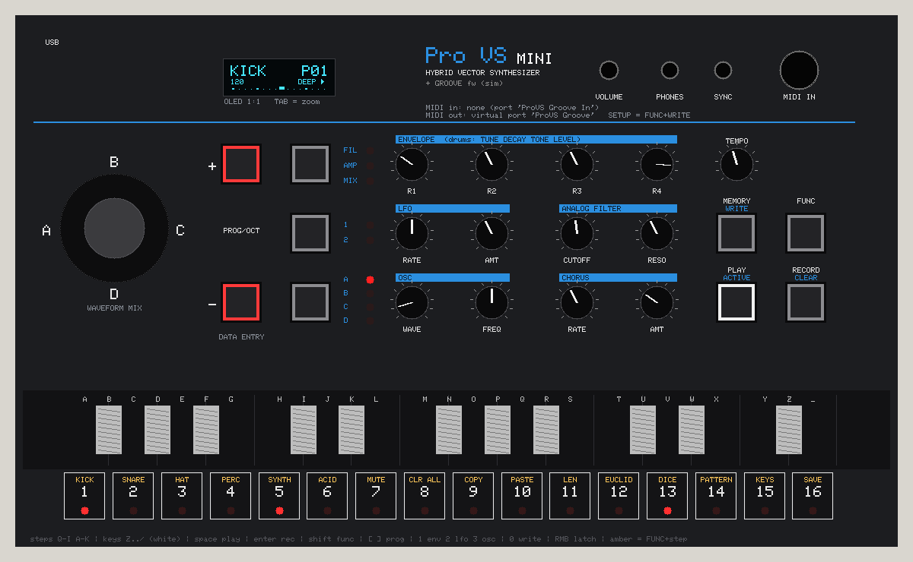

# ProVS Groove

A groovebox firmware for the **Behringer PRO-VS MINI**: four synthesized drum tracks, the vector synth and an acid bass line, a 16-step sequencer with parameter locks, and MIDI clock / SYNC.

Right now it is a portable C++ engine and a desktop simulator of the real panel (macOS, SDL2). **It cannot be put on the hardware yet**: there is no safe, supported way to flash the PRO-VS MINI. See [Getting it onto the hardware](#getting-it-onto-the-hardware).



> **Made with AI.** I vibe-coded this project with Claude (Anthropic). Claude wrote the code; I set the direction and tested it. It is new code written from scratch, with no factory firmware, decompiled code or other proprietary material.

## Build and run

```bash
./build.sh            # bin/render (tests) + bin/provs-groove-sim
./bin/render out      # self-tests, out/demo.wav, OLED dumps, CPU benchmark
./bin/provs-groove-sim
```

Needs clang and SDL2 (`brew install sdl2`). Homebrew's SDL2 in `/usr/local` is x86_64, so the simulator is built for x86_64 and runs under Rosetta; `build.sh` picks the architecture from your SDL2. The engine and tests build natively.

## What's inside

| Track | Engine | Models (OSC button) |
|---|---|---|
| KK | synth kick: sine + pitch envelope + click + drive | DEEP / PUNCH |
| SN | 2 tones + noise through an SVF | SNARE / RIM |
| HH | 6 metallic squares (808 ratios) + noise | CLOSED / OPEN |
| PC | multi-percussion | CLAP / TOM / COWBELL / ZAP |
| SY | vector synth: 5 voices × 4 oscillators (A B C D) with ±24 semitone tuning, 32 built-in waves, joystick mix, 2 LFOs (vector / cutoff), AMP and FIL envelopes, one shared filter (paraphonic, like the original) | — |
| AC | acid bass: mono saw/square, resonant 4-pole low-pass with a decaying envelope, accent (with the sweep that builds up on consecutive accents), slide, drive | SAW / SQUARE |

Sequencer: 16 patterns × 5 tracks × 16 steps. Each track has its own length (polymeter). Per step: accent, probability (1/8…8/8), ratchets ×1–4, a p-lock on any parameter, and on the synth a chord of up to 3 notes and a gate of 1–16 steps, on the acid track a note, gate and slide. There is swing 50–75 %, a tempo-synced ping-pong delay with a send on every track, Euclid fills, DICE (random variation), and copy/paste of a track or a pattern.

## Panel mapping

The layout follows the real panel (traced from photos): 16 step buttons with LEDs, a touch keyboard F…G (27 keys), the joystick, the ENV / LFO / OSC selectors with LEDs, and the 128×32 OLED.

**Step buttons 1–16.** Tap toggles a step. The LEDs show the track and the running light. Hold a step and turn a knob to set a p-lock.

| While holding a step | Action |
|---|---|
| knob | p-lock |
| joystick | lock vector XY (synth) / tune+tone (drums) |
| keyboard key | step note; several keys = chord (acid is mono: last key wins). On a drum track: pitch (TUNE lock) |
| PROG − / + | probability |
| FUNC + PROG − / + | note length (gate) on the synth and acid |
| ENV | accent |
| LFO | ratchet ×1→×4. On the acid track: **slide** (FUNC + LFO = ratchet) |
| OSC | clear all locks on the step |

**FUNC + step** (the amber labels in the simulator):

| 1–6 | 7 | 8 | 9 | 10 | 11 | 12 | 13 | 14 | 15 | 16 |
|---|---|---|---|---|---|---|---|---|---|---|
| track KICK SNARE HAT PERC SYNTH ACID | MUTE mode (steps 1–6 mute tracks) | CLR ALL (pattern) | COPY | PASTE | LEN (then step N) | EUCLID (then step N) | DICE | PATTERN (then step N) | KEYS | SAVE |

To clear just the current track use FUNC + RECORD.

**FUNC + MEMORY WRITE** opens SETUP (sync, see below).

While FUNC is held, the screen shows a legend and the LEDs show the current track. Tap FUNC to leave a mode.

| Button | Action |
|---|---|
| PLAY/ACTIVE | start / stop |
| RECORD | live recording of keys and knobs (quantized) |
| FUNC + RECORD | clear the track (like CLEAR on the panel) |
| PROG − / + | pattern −/+ (while playing, switches at the start of the bar) |
| FUNC + PROG − / + | keyboard octave |
| ENV (FIL/AMP/MIX) | synth: what R1–R4 edit: AMP ADSR / FIL ADSR / MIX (vector X, Y, detune, filter envelope) |
| LFO (1/2) | synth: LFO 1 spins the vector, LFO 2 modulates the cutoff |
| OSC (A–D) | synth: which oscillator WAVE and FREQ edit. Drums: model (LEDs A–D) |
| MEMORY WRITE | save (the simulator writes `state/project.pvg`) |

**Knobs on drum tracks:** R1–R4 = tune / decay / tone / level, FREQ = drive, WAVE = crush, LFO RATE = pan, LFO AMT = sweep/snap/noise, CHORUS AMT = send.
**Knobs on the synth:** R1–R4 follow the ENV selector, WAVE and FREQ (±24 semitones) follow the OSC selector, FUNC+FREQ = detune, LFO RATE/AMT follow the LFO selector, CUTOFF/RESO, FUNC+CUTOFF = filter envelope amount, CHORUS AMT = send.
**Knobs on the acid track:** R1–R4 = cutoff / resonance / env mod / decay, FREQ = tune (±12), WAVE = accent, LFO RATE = drive, LFO AMT = slide time, CHORUS AMT = send. The joystick moves cutoff (X) and env mod (Y) live; hold a step + joystick to lock them.
**Global:** TEMPO (FUNC = swing), CHORUS RATE = delay time (FUNC = feedback).

The keyboard plays the current track: notes on the synth and acid (legato playing on acid glides, and in RECORD it writes slides), a pitched hit on a drum track (the first C is unshifted). FUNC+15 (KEYS) makes the keyboard play the synth from any track.

### Sync: MIDI clock and SYNC

**SETUP:** FUNC + MEMORY WRITE. The LEDs show the current settings. Tap FUNC or MEMORY WRITE to leave.

| Step | Setting |
|---|---|
| 1 / 2 / 3 | clock source: INTERNAL / MIDI / SYNC IN |
| 5 / 6 / 7 / 8 | SYNC jack PPQN: 1 / 2 / 4 / 24 (default 2, like Volca and Pocket Operator) |
| 9 | send MIDI clock + start/stop |
| 10 | send pulses on SYNC (when the jack is not the clock input) |

- **INTERNAL:** 24 PPQN clock, steady and unswung (swing lives only in the sequencer). Start/stop = 0xFA/0xFC. SYNC pulses go out at the chosen PPQN.
- **MIDI:** transport follows 0xFA / 0xFB / 0xFC, and Song Position (0xF2) is supported. Tempo is measured and shown on screen (`MIDI 132`); delay, ratchets and note lengths follow it. If the clock stops, the sequencer holds. The clock is not echoed back to MIDI (avoids loops) but is forwarded to SYNC out, so it works as a MIDI → SYNC converter.
- **SYNC IN:** sixteenths between pulses are interpolated from the measured period and never run ahead of the next pulse. If a pulse comes late, the missing ticks catch up at once, so the grid doesn't drift. PLAY arms the sequencer; it starts on the first pulse. The clock is forwarded to MIDI out (SYNC → MIDI converter).
- **Swing with an external clock** delays the odd steps.
- The TEMPO knob does nothing on an external clock (the screen shows "EXT CLOCK").

**In the simulator:** CoreMIDI. Input is every MIDI source on the Mac plus a virtual port **ProVS Groove In**. Output is a virtual port **ProVS Groove** you can pick in a DAW. Outgoing clock is scheduled with host timestamps rather than "whenever the audio thread got to it", so it doesn't jitter. The MIDI IN and SYNC jacks flash on activity.

**Hardware (HAL):** call `syncPulse()` from the jack's edge interrupt. `popOutput()` returns events timestamped in samples: MIDI bytes for USB/DIN MIDI, edges for SYNC (~5 ms). Incoming events are applied at the audio block boundary, so input jitter equals the block size. On hardware keep blocks small (32–64 samples, about 1 ms).

### The 128×32 screen

The screen is about 22 mm wide, so the rule is one idea per screen. Whatever you are changing is shown large (2× font), labels at 1×, and no grids (the pattern lives on the LEDs).
- **Home:** track and pattern in large type; a line with tempo, swing, model/octave and the REC/KEYS/MUTE flags; a position bar at the bottom.
- **Turning a knob:** parameter name + LOCK/REC badge, the value in large type, a bar.
- **FUNC:** a 4-line legend for FUNC+step.

The 128×32 resolution is inferred from photos of the stock UI (two text lines and a bar). It needs confirming on the board.

## Simulator: computer keyboard

`Q…I` / `A…K` = steps 1–16, `Z X C V B N M , . /` = white keys, `space` = PLAY, `enter` = RECORD, `shift` = FUNC, `[ ]` = PROG−/+, `1 2 3` = ENV/LFO/OSC, `0` = MEMORY WRITE (with `shift` = SETUP), `TAB` = ×4 screen zoom (simulator only).
The screen is drawn 1:1 (one dot per pixel), which on a MacBook is roughly the real size. **Right click** latches a step, key or button, so you can do combinations with one mouse.

## Architecture

```
engine/            portable core: no dependencies, no allocation in the audio path
  groovebox.*      UI logic, sequencer, mixer; lock-free event queue
  synth.*          vector synth + wavetable generation at startup
  acid.h           acid bass voice (own digital filter)
  drums.h fx.h dsp.h
  display.h        128×32 1-bit buffer in SSD1306 page layout (sent to the OLED as is)
  model.h          POD project (~76 KB), written to flash with memcpy
sim/main.cpp       SDL2: panel, mouse/keyboard, audio, CoreMIDI
tools/render.cpp   tests, demo.wav, benchmark
```

HAL boundary: `process()` from the audio DMA; `stepDown/keyDown/buttonDown/pot/joystick/midi` from the panel scan; `drawDisplay()` → OLED, `stepLeds()/led()` → LEDs; `takeSaveRequest()` → flash.

**CPU budget:** on a Mac the engine renders about 210× faster than real time (≈98 ns per stereo sample, all voices including acid). For a Cortex-M7 at 480 MHz that is roughly 5–15 % CPU at 48 kHz, as a rough estimate. Only the real chip will tell.
**Memory:** wavetables 128 KB (float, can shrink to int16), delay buffer 192 KB (int16), project 76 KB. Fits in the 1 MB SRAM of an STM32H750.

## Getting it onto the hardware

The preferred path is a supported one: Behringer / Music Tribe publishing a firmware packer, memory map and schematic for the PRO-VS MINI, as they did for the PRO-800 ([PRO800-Firmware-Packer](https://github.com/MusicTribeOpenSource/PRO800-Firmware-Packer)). The request is in [docs/behringer-request.md](docs/behringer-request.md).

Open questions until then:
1. Confirm the MCU (one forum post says STM32H750VB with read-out protection) and find the SWD pins.
2. Is there external QSPI flash (the H750 has only 128 KB internal)?
3. Pinout: the touch keyboard controller, the 16 step buttons and LEDs, the joystick, 13 pots, 9 buttons, 9 selector LEDs, the OLED (controller, confirm 128×32), the audio DAC/I2S, the cutoff and resonance CV of the analog filter, and the SYNC jack direction.
4. **Does all audio go through the filter?** In the simulator the drums bypass the filter and the filter is emulated with a ladder model. On hardware `Ladder` is replaced by CV to the analog filter. The acid bass keeps its own digital filter either way, because the single analog filter belongs to the vector synth.

**Warning:** removing read-out protection on an STM32 erases the factory firmware. Flashing anything unofficial can brick your unit and void the warranty. Do it at your own risk, on a unit you can afford to lose.

## TODO

- MIDI note output
- Timestamping incoming MIDI/SYNC within the block (precision is the block size for now)
- Arpeggiator on the synth track
- Pattern chains, mute scenes
- STM32 port (libDaisy fits if the chip is confirmed: the Daisy Seed is also an H750)

## License

[AGPL-3.0](LICENSE), the same license Music Tribe uses for its open-source repositories.

Behringer and PRO-VS MINI are trademarks of Music Tribe. This is an independent community project, not affiliated with or endorsed by Music Tribe.
